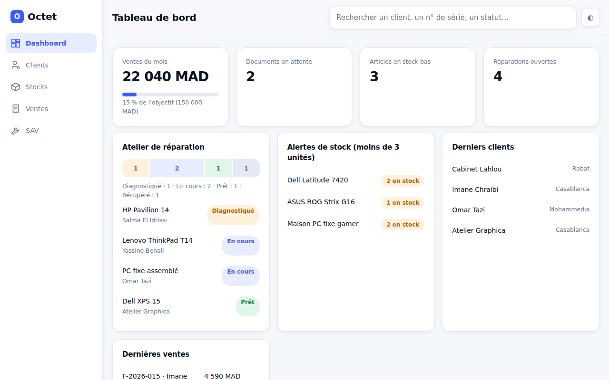
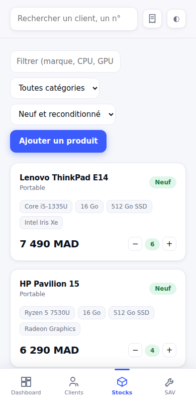

# Octet CRM

CRM open source, gratuit et installable (PWA) pour boutique de vente d'ordinateurs et de matériel informatique.



## Fonctionnalités

- **Tableau de bord** : ventes du mois et objectif, alertes de stock bas, réparations en cours, derniers clients.
- **Clients** : fiche détaillée avec ordinateurs (numéros de série), devis, factures et réparations.
- **Stock** : marque, modèle, CPU, RAM, stockage, GPU, neuf ou reconditionné, prix, quantité. Alerte sous 3 unités, filtres par catégorie et par état.
- **Ventes** : devis, passage en facture, statuts En attente / Payé / Annulé. Le stock baisse quand une facture est payée.
- **SAV** : suivi des machines déposées (Diagnostiqué, En cours, Prêt, Récupéré).
- **Recherche globale** : client, numéro de série, produit ou statut de réparation.
- **Interface** : thème clair et sombre, barre de navigation basse sur mobile, installable, utilisable hors-ligne.

| Mobile |
|---|
|  |

## Utiliser en local

Aucune installation : ouvre `index.html` dans un navigateur.
Pour tester le mode PWA (service worker), lance un petit serveur :

```bash
python3 -m http.server 8000
# puis ouvre http://localhost:8000
```

## Déployer en ligne

### GitHub Pages (inclus)

1. Pousse ce dossier sur un dépôt GitHub public.
2. Dans **Settings → Pages**, choisis **Source : GitHub Actions**.
3. Chaque `push` sur `main` redéploie le site via `.github/workflows/pages.yml`.

Le site sera disponible sur `https://TON-COMPTE.github.io/NOM-DU-DEPOT/`.

### Cloudflare Pages ou Netlify

Connecte le dépôt, laisse la commande de build vide et indique `.` comme dossier de publication.

## Données

Les données d'exemple sont enregistrées dans le `localStorage` du navigateur : elles restent sur l'appareil et ne sont pas partagées entre postes. **N'enregistre pas de vraies données clients dans un dépôt public.** Pour un usage multi-postes, il faudra brancher une base en ligne avec authentification (Supabase ou Firebase, par exemple).

## Mettre à jour l'application

Modifie `index.html`, puis change la valeur de `VERSION` dans `sw.js` (par exemple `octet-v2`) pour que les appareils déjà installés récupèrent la nouvelle version.

## Pistes d'évolution

- Base de données partagée et connexion des utilisateurs
- Export des factures en PDF
- Modification et suppression des enregistrements
- Relances clients et rappels de garantie

## Contribuer

Les contributions sont les bienvenues : ouvre une *issue* pour proposer une idée ou signaler un bug, ou une *pull request* pour proposer une modification.

## Licence

[MIT](LICENSE)
